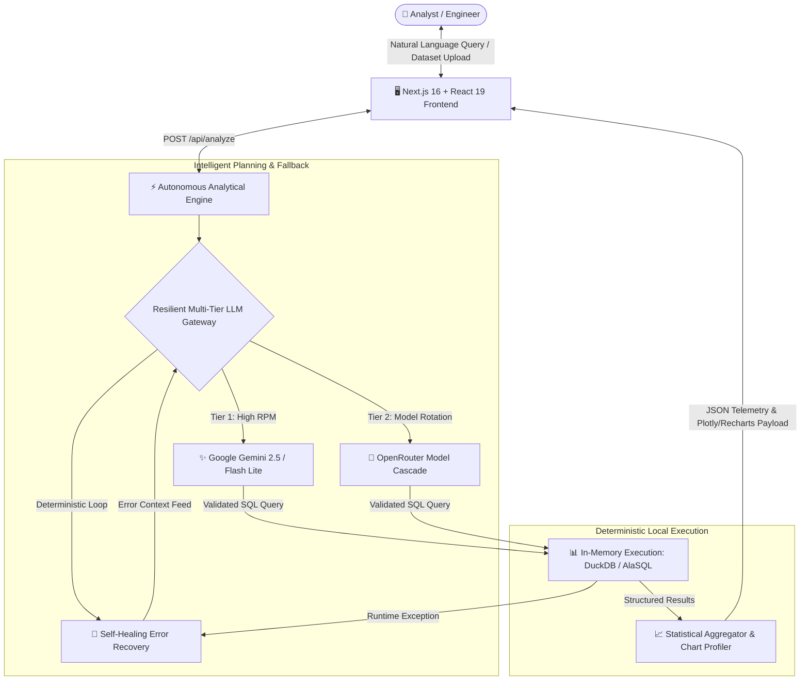

# DataPilot AI — Autonomous Tabular Intelligence Agent & Execution Engine

[](https://nextjs.org/)
[](https://react.dev/)
[](https://www.typescriptlang.org/)
[](https://duckdb.org/)
[](https://tailwindcss.com/)
[](https://opensource.org/licenses/MIT)

> **DataPilot AI** is an autonomous tabular data intelligence agent that translates natural language questions into verified, in-memory SQL execution, automated anomaly detection, statistical distribution profiling, and interactive visualizations.

---

## 📌 Executive Summary

Modern business analysts and engineers spend countless hours manually writing SQL queries, inspecting tabular anomalies, and preparing executive charts. **DataPilot AI** eliminates this friction by coupling **frontier LLM planning with in-memory analytical databases (DuckDB & AlaSQL)**. 

Users upload CSV or Excel datasets and pose questions in plain English. The agent autonomously examines schemas, infers column semantics, generates deterministic SQL queries, executes them locally with zero database roundtrips, and renders interactive analytical dashboards.

---

## 🏗️ Architecture Overview



---

## 🌟 Key Capabilities

### 1. In-Memory Sub-Second SQL Analytics (DuckDB & AlaSQL)
* **Zero Database Bottlenecks:** Queries execute entirely in-memory using DuckDB and AlaSQL, delivering sub-10ms aggregations over hundreds of thousands of rows.
* **Privacy & Isolation:** Raw customer records are parsed in local memory without leaving your controlled infrastructure.

### 2. Multi-Tier Resilient LLM Cascade
* **Automated Failover:** Built-in model routing through **Google Gemini Flash Lite** and an **OpenRouter free models cascade** (`gemma-4`, `nemotron-3.5`).
* **Zero Downtime:** Intelligent backoff and model rotation ensure queries are serviced reliably during rate limits or provider downtime.

### 3. Self-Healing Execution Loop
* **Deterministic Code Verification:** When generated SQL encounters a column mismatch or syntax error, the runtime error message is automatically piped back into the reasoning loop for immediate correction without user intervention.

### 4. Automated Statistical & Anomaly Profiling
* **Outlier & Distribution Analysis:** Automatically identifies IQR anomalies, correlation clusters, z-score spikes, and missing-value patterns upon dataset ingest.
* **Executive Markdown Briefings:** Generates concise, structured executive summaries outlining revenue drivers, churn factors, and trend vectors.

### 5. Dynamic Visualizations
* **Natural Language Charting:** Autonomously selects the optimal visualization format (stacked bar, line chart, scatter plot, or radar) via Recharts and Chart.js based on data cardinality.

---

## 🛠️ Tech Stack

| Component | Technology | Rationale |
| :--- | :--- | :--- |
| **Framework** | Next.js 16.3.8 (App Router) | Server-side execution, React Server Components, zero-bundle API routes |
| **UI Library** | React 19.2.8 + TailwindCSS 4 | Sleek modern glassmorphism, instant state responsiveness |
| **Query Engine** | DuckDB & AlaSQL | In-memory relational queries with standard ANSI SQL compliance |
| **Parser** | PapaParse | Chunked, high-throughput tabular parsing |
| **Visualization** | Recharts & Chart.js | Declarative, accessible, animated data charting |
| **AI Orchestration** | `@google/genai` & OpenRouter API | Low-latency schema inference and self-healing SQL generation |

---

## 🚀 Getting Started

### Prerequisites
* **Node.js**: `v20.0.0` or higher
* **npm** or **pnpm**

### Installation

1. **Clone the repository:**
   ```bash
   git clone https://github.com/harkiratsinghh27-sketch/datapilot-ai.git
   cd datapilot-ai
   ```

2. **Install dependencies:**
   ```bash
   npm install
   ```

3. **Configure Environment Variables:**
   Create a `.env.local` file in the project root:
   ```env
   # Google Gemini API Key (Recommended for Tier 1)
   GEMINI_API_KEY=your_gemini_api_key_here

   # Optional: OpenRouter API Key (For Tier 2 fallback)
   OPENROUTER_API_KEY=your_openrouter_api_key_here
   ```

4. **Start the Development Server:**
   ```bash
   npm run dev
   ```

5. **Open the Application:**
   Visit [http://localhost:3000](http://localhost:3000) in your browser.

---

## 📊 Sample Queries to Try

Once you upload any tabular dataset (e.g. sales records, telemetry, churn metrics):
* *"What is the month-over-month revenue growth by region?"*
* *"Identify any outliers in unit cost and flag suspicious transaction amounts."*
* *"Show a breakdown of top 10 customers by lifetime value and calculate churn risk."*
* *"Plot the correlation between customer support ticket volume and retention."*

---

## 📄 License

This project is licensed under the [MIT License](LICENSE).
