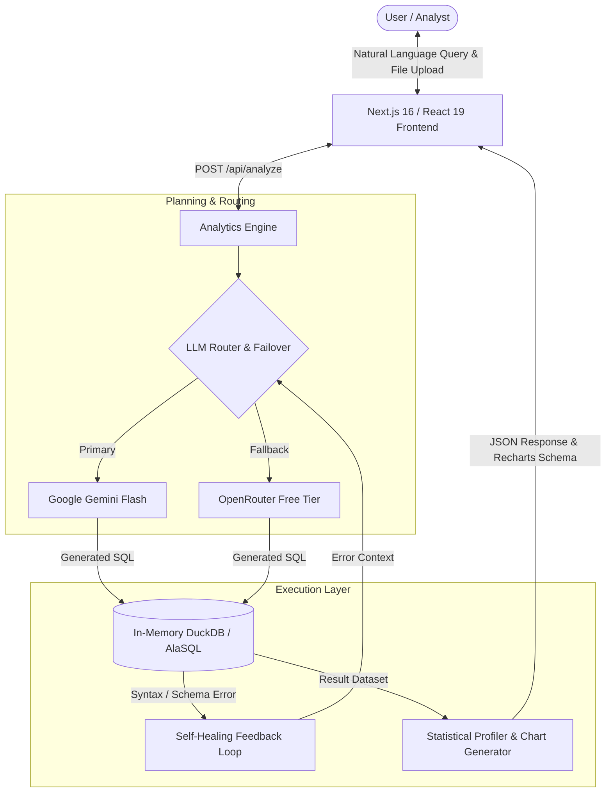

# DataPilot AI

> In-memory tabular data analytics engine with natural language querying, automated anomaly profiling, and self-healing SQL execution.

[](https://datapilot-ai-sandy.vercel.app)
[](https://nextjs.org/)
[](https://react.dev/)
[](https://www.typescriptlang.org/)
[](https://duckdb.org/)
[](https://opensource.org/licenses/MIT)

**Live Production URL:** [https://datapilot-ai-sandy.vercel.app](https://datapilot-ai-sandy.vercel.app)

---

## Overview

DataPilot AI is a web-based data exploration and analytics tool built for analysts and engineers who need quick answers from tabular datasets (CSV/TSV/JSON) without manually writing SQL queries or configuring BI dashboards.

Instead of transmitting customer datasets to third-party databases, DataPilot parses files directly in-memory using **DuckDB** and **AlaSQL**. Users type queries in natural language, and the system dynamically infers the schema, generates standard ANSI SQL, executes the query against local memory, and renders interactive charts.

---

## Architecture



---

## Key Technical Decisions

### 1. In-Memory Relational Processing (DuckDB & AlaSQL)
* **Rationale:** Uploaded files should not require provisioning remote databases or creating persistent tables in a shared database cluster. 
* **Implementation:** Tabular files are loaded directly into in-memory table structures. Aggregations, joins, and filters execute with sub-10ms response times.
* **Serverless Resilience:** Added an automated re-hydration mechanism that transparently re-seeds the in-memory table in `/tmp` if a serverless container cold-starts during an active session.

### 2. Multi-Model Failover Cascade
* **Rationale:** Relying on a single LLM API endpoint creates vulnerability to rate limits (HTTP 429) or transient provider outages.
* **Implementation:** The backend routes primarily through Google Gemini (`gemini-flash-lite-latest`) with automatic, zero-downtime failover to OpenRouter endpoints with exponential backoff.

### 3. Self-Healing SQL Error Recovery
* **Rationale:** Language models occasionally produce queries targeting non-existent column variations or using engine-incompatible syntax.
* **Implementation:** If the in-memory execution engine returns a SQL error, the exact syntax error is fed back into the model prompt along with the verified schema columns for immediate retry, resolving syntax failures without requiring user intervention.

### 4. Automated Anomaly & Distribution Profiling
* Computes IQR distributions, missing value percentages, and numeric outliers upon file upload.
* Automatically selects appropriate chart representations (bar, line, scatter) based on returned cardinality and data types.

---

## Tech Stack

| Layer | Technologies |
| :--- | :--- |
| **Frontend** | Next.js 16.3.8 (App Router), React 19.2.8, TailwindCSS 4, Lucide Icons |
| **In-Memory Engines** | DuckDB (`duckdb`), AlaSQL (`alasql`), PapaParse (`papaparse`) |
| **Visualization** | Recharts, Chart.js |
| **Model Integration** | `@google/genai`, OpenRouter REST API |
| **Deployment** | Vercel Serverless Edge Network |

---

## Getting Started

### Prerequisites
* Node.js 20.0 or higher
* npm or pnpm
* Gemini API Key (get one free at [Google AI Studio](https://aistudio.google.com/))

### Local Setup

1. **Clone the repository:**
   ```bash
   git clone https://github.com/harkiratsinghh27-sketch/Datapilot-ai.git
   cd Datapilot-ai
   ```

2. **Install dependencies:**
   ```bash
   npm install
   ```

3. **Set environment variables:**
   Create a `.env.local` file:
   ```env
   GEMINI_API_KEY=your_gemini_api_key
   # Optional fallback:
   OPENROUTER_API_KEY=your_openrouter_key
   ```

4. **Run the local dev server:**
   ```bash
   npm run dev
   ```
   Open `http://localhost:3000` to run the interface locally.

---

## License

MIT License. See [LICENSE](LICENSE) for details.
